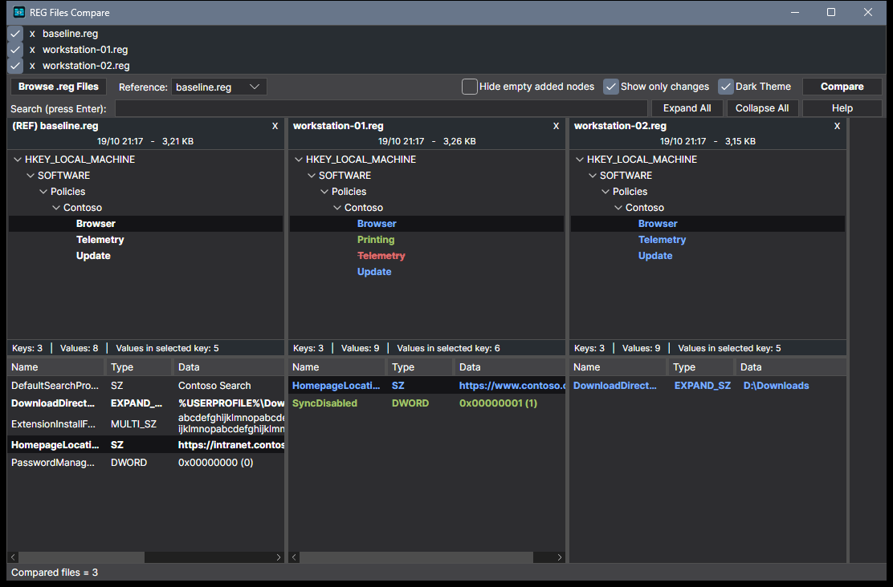

# REG Files Compare

A small Windows GUI tool to **compare multiple `.reg` files side by side** against a reference — fast, even with exports of tens of thousands of keys.

## ✨ Features

* 🗂️ **Multi-file compare** with a selectable **reference file**.
* 🌲 **Tree of keys** + 📋 **grid of values** per file, kept **in sync** (the selected key and value follow in every column).
* 🎯 **Diff highlighting**
  * 🟩 **Added**
  * 🟥 **Missing**
  * 🔵 **Different data**
* 🧠 **Compares the data, not its spelling**: `dword:0000000A` = `hex(4):0a,00,00,00`, and REGEDIT4 (ANSI) and version 5 (UTF-16) exports of the same text match.
* 🧹 **Show only changes** and **Hide empty added nodes** filters (non-reference columns).
* 🔎 **Search** across every file, in a dedicated results column.
* 📤 **Copy & export**: copy key names, a branch as a text tree, or values as text; export a branch or chosen values to a new `.reg` file.
* 🖱️ **Drag & drop** files or folders on the window or on the exe's icon, give them on the command line, or use **Browse**.
* ⚡ **Big files**: virtualized trees and grids, loading in the background.
* 🌙 **Themes** Dark & Light.
* 📚 **Built-in documentation** in English and French, with a live value sandbox: the **Help** button or **F1**.

---

## 📸 Screenshot

---

## Installation

No installation required — it is a single self-contained file (no .NET runtime needed), signed by Leo Antonin Gillet.

**➡️ [Download Reg_Files_Compare.exe](https://github.com/Freenitial/Reg_Files_Compare/releases/latest/download/Reg_Files_Compare.exe)**

Then just double-click to open, or drop `.reg` files (or folders) on it: two or more are compared at once. The application reads files only: it never touches your registry.

## Documentation

The **Help** button (or **F1**) opens the full documentation in your browser, in English or French: a guide, then a technical reference that describes how it works (parsing, comparison rules, colors, search, export, security). It ships inside the executable and works offline; its source is [docs/help.html](docs/help.html).

## Build from source (optional)

Most users don't need this — just download the executable above. If you'd rather compile it yourself, see **[BUILD.md](https://github.com/Freenitial/Reg_Files_Compare/blob/main/BUILD.md)**.

## Requirements

- Windows 10 version 1809 (build 17763) or later, 64-bit.
